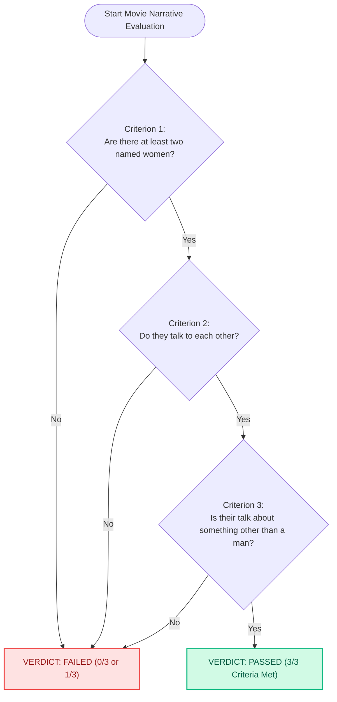

# BechdelTest Study: Vue 3 Architecture & Declarative Logic State Machines Guide

[](https://vuejs.org/)
[](https://vitejs.dev/)
[](LICENSE)
[](https://www.bechdeltest.org)
[-green.svg?style=flat-square)](#)
[](#)

---

## 🌐 Original Platform Overview: What is the Bechdel Test?

The original cultural platform [**bechdeltest.org**](https://www.bechdeltest.org) is an internationally recognized cinema analysis database evaluating gender representation and narrative agency in films using the celebrated **Bechdel-Wallace Test**.

### The Core Problem Solved
Introduced in 1985 by cartoonist Alison Bechdel (in her comic strip *Dykes to Watch Out For*), the Bechdel Test serves as an intuitive metric to highlight how frequently mainstream cinema sidelines female characters into mere romantic foils or accessories to male protagonists.

### The Three Canonical Criteria
To achieve a **PASS** rating on [bechdeltest.org](https://www.bechdeltest.org), a movie must satisfy three strict rules:
1. **Rule 1 (Named Women)**: Features at least two women characters who have explicit names.
2. **Rule 2 (Direct Conversation)**: These two named women share at least one direct, reciprocal conversation.
3. **Rule 3 (Topic Beyond Men)**: Their conversation is about something other than a man (e.g., survival, science, philosophy, or their own goals).

### Original Platform Features
At [bechdeltest.org](https://www.bechdeltest.org), the service provides:
- A historical archive of over 10,000 films from silent cinema to modern blockbusters.
- Dialogue excerpts and scene citations documenting where criteria passed or failed.
- Statistical trends in cinematic narrative diversity.

---

## 🎯 Educational Edition Scope & Pedagogical Goals

This repository (`bechdeltest-study`) is an **isolated front-end educational shell** replicating the visual design and diagnostic workflow of a modern AI-assisted Bechdel Test analyzer.

> **Important Student Notice**:  
> To create an accessible, leak-proof learning environment, this educational build runs entirely on client-side reactive mock datasets. There are **no external LLM API keys, no backend databases, and zero `.env` environment secrets**.

### Key Learning Outcomes
- Designing **declarative boolean decision trees** and state machines in JavaScript.
- Mastering **dynamic class binding patterns (`:class`)** to reflect multi-tier status states.
- Preloading benchmark dataset records into reactive form models.

---

## 📸 Architectural Visualizations

### 1. Bechdel Test Three-Tiered Decision Logic Flowchart


### 2. State-to-Badge UI Component Flow
```mermaid
flowchart LR
    subgraph "Preset Selection or Search"
        SelectPreset["User clicks Preset Chip (e.g. Barbie / Oppenheimer)"]
        FormInput["Custom Title Input via v-model"]
    end

    SelectPreset --> Engine{"Analysis Engine"}
    FormInput --> Engine

    subgraph "Reactive State Resolution"
        Engine --> ResRecord["currentResult: ref&lt;MovieRecord&gt;"]
        ResRecord --> Overall{"overall: 'pass' | 'fail'"}
        ResRecord --> CriteriaSet["criteria: { c1, c2, c3 }"]
    end

    subgraph "DOM Template Bindings"
        Overall --> ClassBanner[":class=\"currentResult.overall\" -> Green/Red Banner"]
        CriteriaSet --> C1Dom[":class=\"{ passed: criteria.c1 }\" -> C1 Badge"]
        CriteriaSet --> C2Dom[":class=\"{ passed: criteria.c2 }\" -> C2 Badge"]
        CriteriaSet --> C3Dom[":class=\"{ passed: criteria.c3 }\" -> C3 Badge"]
    end
```

---

## 🔬 In-Depth Concept: Declarative Dynamic Class Binding (`:class`) in Vue 3

A hallmark of clean frontend development is declarative styling: an element's visual appearance should automatically project its underlying data state.

### Imperative vs. Declarative State-Driven Styling
In legacy imperative code, developers manually toggled classes using `classList.add('pass')` and `classList.remove('fail')`. In Vue 3, classes are bound directly to reactive state expressions.

### 1. Object Syntax for Conditional Class Toggling
In `BechdelFinderCore.vue`, each criterion card displays a green accent border when met, and a red accent border when failed:

```html
<div
  class="criterion-item"
  :class="{ passed: currentResult.criteria.c1 }"
>
  <div class="crit-header">
    <span class="crit-status">
      {{ currentResult.criteria.c1 ? '✔ Criterion 1 Met' : '✖ Criterion 1 Failed' }}
    </span>
    <h4 class="crit-title">At least two named women</h4>
  </div>
  <p class="crit-detail">{{ currentResult.c1Details }}</p>
</div>
```

**How it works**:  
The object syntax `{ passed: boolean }` instructs Vue to apply the CSS class `passed` if and only if `currentResult.criteria.c1` is truthy. When the user selects another movie, Vue automatically updates the class list during the next microtask tick without direct DOM manipulation.

### 2. Direct Expression Class Binding
For the overall verdict banner, we bind the status string directly:

```html
<div
  class="verdict-banner"
  :class="currentResult.overall"
>
  <!-- Renders class="verdict-banner pass" or class="verdict-banner fail" -->
</div>
```

```css
/* Component scoped CSS styles */
.verdict-banner.pass {
  background: var(--pass-light);
  border: 1px solid #a7f3d0;
}

.verdict-banner.fail {
  background: var(--fail-light);
  border: 1px solid #fecaca;
}
```

### 3. Merging Static and Dynamic Classes
Vue merges static classes and dynamic bindings seamlessly:
```html
<button
  class="chip-btn"
  :class="{ selected: selectedMovieId === movie.id }"
  @click="loadPreset(movie)"
>
  {{ movie.title }}
</button>
```
The resulting DOM element always retains `chip-btn`, adding or removing `selected` dynamically.

---

## 📁 Source Code Directory Breakdown

```text
bechdeltest-study/
├── index.html                   # Entry HTML document with clapperboard favicon
├── package.json                 # Dependency manifest for Vue 3 and Vite
├── vite.config.js               # Dev server configuration (Configured for Port 3004)
├── README.md                    # Detailed architectural and instructional guide
└── src/
    ├── main.js                  # Application entry mounting App.vue to #app
    ├── App.vue                  # Main layout organizing headers, analyzer, and showcases
    ├── style.css                # Violet/rose cinematic color palette and variables
    ├── data/
    │   └── mockData.js          # Canonical movie analysis benchmark records
    └── components/
        ├── Navbar.vue           # Header with cinematic branding and info modal trigger
        ├── HeroSection.vue      # Introduction explaining the 3 Bechdel test criteria
        ├── BechdelFinderCore.vue# Interactive analyzer with presets and verdict breakdown
        ├── MovieShowcase.vue    # Grid of historical movie test benchmarks
        ├── FaqSection.vue       # Accordion addressing common methodology questions
        └── FooterSection.vue    # Semantic footer with pedagogical notices
```

---

## 🛠️ Component Implementation Details

### 1. `BechdelFinderCore.vue`
- **Benchmark Presets**: Features one-click buttons for landmark films (*Barbie*, *Oppenheimer*, *Alien*, *The Dark Knight*). Clicking a chip synchronously loads verified movie breakdowns.
- **Dynamic Fallback**: If a student enters an unlisted movie title, a simulation engine dynamically generates a structured sample report to demonstrate UI responsiveness.
- **Three-Tier Diagnostics**: Breaks down Criterion 1 (Named Women), Criterion 2 (Conversation), and Criterion 3 (Non-Male Topics) with concrete dialogue citations.

### 2. `MovieShowcase.vue`
- Demonstrates card grid layouts mapping across static arrays with sub-badge checks for rapid visual comparison.

---

## 🚀 Getting Started

### Prerequisites
- **Node.js**: `v18.0.0` or higher (Tested on `v23.11.0`)
- **Package Manager**: `npm` (v10+), `pnpm`, or `yarn`

### Installation & Local Development
```bash
# 1. Navigate to the project directory
cd bechdeltest-study

# 2. Install dependencies
npm install

# 3. Start the Vite development server
npm run dev
```

Visit the local development server:
```
http://localhost:3004
```

### Production Build
```bash
# Build the production package into dist/
npm run build

# Preview the production output locally
npm run preview
```

---

## 🎓 Recommended Exercises for Students

1. **Exercise 1: Pass Rate Metric**:  
   Compute the overall pass percentage across all movies in `PRESET_MOVIES` using `computed(() => ...)` and render a visual progress bar.
2. **Exercise 2: Status Filter Buttons**:  
   Add a toggle button in `MovieShowcase.vue` to filter between "Show All", "Passed Only", and "Failed Only".
3. **Exercise 3: User Evaluation Form**:  
   Add an interactive form allowing students to submit their own movie evaluation with 3 checkboxes and append it into the local reactive array.
